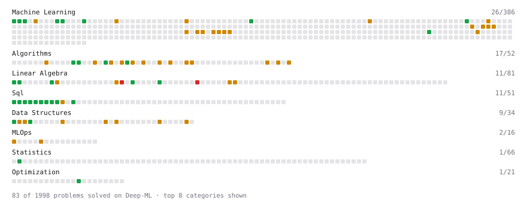

# Deep-ML

My machine learning practice from [Deep-ML](https://www.deep-ml.com). Every solution here was written by hand.

**76** solved · 71 problems · 0 labs · 5 math

[**Browse the interactive portfolio**](https://r-muimih.github.io/deep-ml/) to replay this filling in over time.

## Problems

| | Difficulty | Solved | |
| --- | --- | --- | --- |
| [Average per group](https://www.deep-ml.com/problems/1108) | easy | 2026-11-02 | [solution](problems/1108-average-per-group) |
| [Batch Iterator for Dataset](https://www.deep-ml.com/problems/30) | easy | 2026-11-01 | [solution](problems/0030-batch-iterator-for-dataset) |
| [Calculate 2x2 Matrix Inverse](https://www.deep-ml.com/problems/8) | easy | 2026-11-01 | [solution](problems/0008-calculate-2x2-matrix-inverse) |
| [Count rows per group](https://www.deep-ml.com/problems/1107) | easy | 2026-11-02 | [solution](problems/1107-count-rows-per-group) |
| [Count Words Appearing Exactly Once in Each of Two Lists](https://www.deep-ml.com/problems/1141) | easy | 2026-11-09 | [solution](problems/1141-count-words-appearing-exactly-once-in-each-of-two-lists) |
| [Delete Duplicate Emails Keeping One](https://www.deep-ml.com/problems/1112) | easy | 2026-11-02 | [solution](problems/1112-delete-duplicate-emails-keeping-one) |
| [Derivative of a Polynomial](https://www.deep-ml.com/problems/116) | easy | 2026-11-01 | [solution](problems/0116-derivative-of-a-polynomial) |
| [Descriptive Statistics Calculator](https://www.deep-ml.com/problems/78) | easy | 2026-11-01 | [solution](problems/0078-descriptive-statistics-calculator) |
| [Dot Product Calculator](https://www.deep-ml.com/problems/83) | easy | 2026-11-01 | [solution](problems/0083-dot-product-calculator) |
| [Feature Scaling Implementation](https://www.deep-ml.com/problems/16) | easy | 2026-11-01 | [solution](problems/0016-feature-scaling-implementation) |
| [Filter rows with WHERE](https://www.deep-ml.com/problems/1103) | easy | 2026-11-02 | [solution](problems/1103-filter-rows-with-where) |
| [First N Fibonacci Numbers](https://www.deep-ml.com/problems/1151) | easy | 2026-11-09 | [solution](problems/1151-first-n-fibonacci-numbers) |
| [Gradient Direction and Magnitude](https://www.deep-ml.com/problems/308) | easy | 2026-11-01 | [solution](problems/0308-gradient-direction-and-magnitude) |
| [Implement Orthogonal Projection of a Vector onto a Line](https://www.deep-ml.com/problems/66) | easy | 2026-11-01 | [solution](problems/0066-implement-orthogonal-projection-of-a-vector-onto-a-line) |
| [Label Encoding for Ordinal Variables](https://www.deep-ml.com/problems/356) | easy | 2026-11-01 | [solution](problems/0356-label-encoding-for-ordinal-variables) |
| [Learning Rate Range Finder for Linear Regression](https://www.deep-ml.com/problems/990) | easy | 2026-11-01 | [solution](problems/0990-learning-rate-range-finder-for-linear-regression) |
| [Linear Regression Using Gradient Descent](https://www.deep-ml.com/problems/15) | easy | 2026-11-01 | [solution](problems/0015-linear-regression-using-gradient-descent) |
| [Linear Regression Using Normal Equation](https://www.deep-ml.com/problems/14) | easy | 2026-11-01 | [solution](problems/0014-linear-regression-using-normal-equation) |
| [Matrix-Vector Dot Product](https://www.deep-ml.com/problems/1) | easy | 2026-11-01 | [solution](problems/0001-matrix-vector-dot-product) |
| [Min-Max Scaling of Feature Values](https://www.deep-ml.com/problems/112) | easy | 2026-11-01 | [solution](problems/0112-min-max-scaling-of-feature-values) |
| [One-Hot Encoding of Nominal Values](https://www.deep-ml.com/problems/34) | easy | 2026-11-01 | [solution](problems/0034-one-hot-encoding-of-nominal-values) |
| [Random Shuffle of Dataset](https://www.deep-ml.com/problems/29) | easy | 2026-11-01 | [solution](problems/0029-random-shuffle-of-dataset) |
| [Random Train/Validation/Test Split with Shuffling](https://www.deep-ml.com/problems/1058) | easy | 2026-11-01 | [solution](problems/1058-random-train-validation-test-split-with-shuffling) |
| [Remove duplicates with DISTINCT](https://www.deep-ml.com/problems/1105) | easy | 2026-11-02 | [solution](problems/1105-remove-duplicates-with-distinct) |
| [SELECT all rows](https://www.deep-ml.com/problems/1101) | easy | 2026-11-02 | [solution](problems/1101-select-all-rows) |
| [Select specific columns](https://www.deep-ml.com/problems/1102) | easy | 2026-11-02 | [solution](problems/1102-select-specific-columns) |
| [Shift and Scale Array to Target Range](https://www.deep-ml.com/problems/141) | easy | 2026-11-01 | [solution](problems/0141-shift-and-scale-array-to-target-range) |
| [Sort results with ORDER BY](https://www.deep-ml.com/problems/1104) | easy | 2026-11-02 | [solution](problems/1104-sort-results-with-order-by) |
| [Top N with LIMIT](https://www.deep-ml.com/problems/1106) | easy | 2026-11-02 | [solution](problems/1106-top-n-with-limit) |
| [Top-K Largest Elements in a List](https://www.deep-ml.com/problems/1137) | easy | 2026-11-09 | [solution](problems/1137-top-k-largest-elements-in-a-list) |
| [Transpose of a Matrix](https://www.deep-ml.com/problems/2) | easy | 2026-11-01 | [solution](problems/0002-transpose-of-a-matrix) |
| [Valid Palindrome II (Delete At Most One Char)](https://www.deep-ml.com/problems/1160) | easy | 2026-11-09 | [solution](problems/1160-valid-palindrome-ii-delete-at-most-one-char) |
| [Your first JOIN](https://www.deep-ml.com/problems/1109) | easy | 2026-11-02 | [solution](problems/1109-your-first-join) |
| [Array Drills: Product Except Self, 3Sum, Find Peak, Maximum Swap](https://www.deep-ml.com/problems/1173) | medium | 2026-11-09 | [solution](problems/1173-array-drills-product-except-self-3sum-find-peak-maximum-swap) |
| [Array Drills: Stock Profit, House Robber and the Single Non-Duplicate](https://www.deep-ml.com/problems/1554) | medium | 2026-11-09 | [solution](problems/1554-array-drills-stock-profit-house-robber-and-the-single-non-duplicate) |
| [Array/Matrix Drills: Ocean View, Toeplitz, Diagonal Traverse](https://www.deep-ml.com/problems/1169) | medium | 2026-11-09 | [solution](problems/1169-array-matrix-drills-ocean-view-toeplitz-diagonal-traverse) |
| [Bias-Variance Decomposition from Bootstrap](https://www.deep-ml.com/problems/804) | medium | 2026-11-03 | [solution](problems/0804-bias-variance-decomposition-from-bootstrap) |
| [Binary Search for Value or Closest Index](https://www.deep-ml.com/problems/1216) | medium | 2026-11-09 | [solution](problems/1216-binary-search-for-value-or-closest-index) |
| [Build a Simple ETL Pipeline (MLOps)](https://www.deep-ml.com/problems/187) | medium | 2026-11-03 | [solution](problems/0187-build-a-simple-etl-pipeline-mlops) |
| [Chain Rule for Composite Functions](https://www.deep-ml.com/problems/214) | medium | 2026-11-01 | [solution](problems/0214-chain-rule-for-composite-functions) |
| [Cholesky Decomposition](https://www.deep-ml.com/problems/334) | medium | 2026-11-01 | [solution](problems/0334-cholesky-decomposition) |
| [Clean a Messy Dataset: Dedup, Standardize, Impute](https://www.deep-ml.com/problems/1131) | medium | 2026-11-03 | [solution](problems/1131-clean-a-messy-dataset-dedup-standardize-impute) |
| [ColumnTransformer-Style Dispatcher](https://www.deep-ml.com/problems/845) | medium | 2026-11-01 | [solution](problems/0845-columntransformer-style-dispatcher) |
| [Count Subarrays Summing to K (Prefix-Sum Hash Map)](https://www.deep-ml.com/problems/1161) | medium | 2026-11-09 | [solution](problems/1161-count-subarrays-summing-to-k-prefix-sum-hash-map) |
| [Data Quality Scoring for ML Pipelines](https://www.deep-ml.com/problems/252) | medium | 2026-11-03 | [solution](problems/0252-data-quality-scoring-for-ml-pipelines) |
| [Detect Look-Ahead Bias in a Feature Pipeline](https://www.deep-ml.com/problems/1352) | medium | 2026-11-02 | [solution](problems/1352-detect-look-ahead-bias-in-a-feature-pipeline) |
| [Detect Target Leakage in a Feature Matrix](https://www.deep-ml.com/problems/1359) | medium | 2026-11-02 | [solution](problems/1359-detect-target-leakage-in-a-feature-matrix) |
| [Dummy Classifier Baseline](https://www.deep-ml.com/problems/847) | medium | 2026-11-01 | [solution](problems/0847-dummy-classifier-baseline) |
| [Dummy Regressor Baseline](https://www.deep-ml.com/problems/848) | medium | 2026-11-02 | [solution](problems/0848-dummy-regressor-baseline) |
| [Feature Hashing Trick for Sparse Features](https://www.deep-ml.com/problems/846) | medium | 2026-11-01 | [solution](problems/0846-feature-hashing-trick-for-sparse-features) |
| [Gaussian Elimination for Solving Linear Systems](https://www.deep-ml.com/problems/58) | medium | 2026-11-01 | [solution](problems/0058-gaussian-elimination-for-solving-linear-systems) |
| [Handle Missing Data with Imputation](https://www.deep-ml.com/problems/354) | medium | 2026-11-01 | [solution](problems/0354-handle-missing-data-with-imputation) |
| [Implement Gradient Descent Variants with MSE Loss](https://www.deep-ml.com/problems/47) | medium | 2026-11-01 | [solution](problems/0047-implement-gradient-descent-variants-with-mse-loss) |
| [Implement K-Fold Cross-Validation](https://www.deep-ml.com/problems/18) | medium | 2026-11-01 | [solution](problems/0018-implement-k-fold-cross-validation) |
| [Implement Stratified K-Fold Cross-Validation](https://www.deep-ml.com/problems/840) | medium | 2026-11-01 | [solution](problems/0840-implement-stratified-k-fold-cross-validation) |
| [Implement Stratified Train-Test Split](https://www.deep-ml.com/problems/275) | medium | 2026-11-01 | [solution](problems/0275-implement-stratified-train-test-split) |
| [Learning Curve Generator for Bias-Variance Diagnosis](https://www.deep-ml.com/problems/800) | medium | 2026-11-03 | [solution](problems/0800-learning-curve-generator-for-bias-variance-diagnosis) |
| [Linear Regression - Power Grid Optimization](https://www.deep-ml.com/problems/92) | medium | 2026-11-01 | [solution](problems/0092-linear-regression-power-grid-optimization) |
| [Longest Substring / Subarray with Two Pointers](https://www.deep-ml.com/problems/1148) | medium | 2026-11-09 | [solution](problems/1148-longest-substring-subarray-with-two-pointers) |
| [LU Decomposition of a Square Matrix](https://www.deep-ml.com/problems/333) | medium | 2026-11-01 | [solution](problems/0333-lu-decomposition-of-a-square-matrix) |
| [Matrix times Matrix ](https://www.deep-ml.com/problems/9) | medium | 2026-11-01 | [solution](problems/0009-matrix-times-matrix) |
| [Mini-Batch Gradient Descent Step for Linear Regression](https://www.deep-ml.com/problems/803) | medium | 2026-11-01 | [solution](problems/0803-mini-batch-gradient-descent-step-for-linear-regression) |
| [Nth-Highest Salary with Ties and NULL](https://www.deep-ml.com/problems/1110) | medium | 2026-11-02 | [solution](problems/1110-nth-highest-salary-with-ties-and-null) |
| [Numerical Gradient Checking](https://www.deep-ml.com/problems/313) | medium | 2026-11-01 | [solution](problems/0313-numerical-gradient-checking) |
| [Ordinal Encoding for Categorical Features](https://www.deep-ml.com/problems/843) | medium | 2026-11-01 | [solution](problems/0843-ordinal-encoding-for-categorical-features) |
| [Outlier Detection and Removal Using IQR Method](https://www.deep-ml.com/problems/355) | medium | 2026-11-01 | [solution](problems/0355-outlier-detection-and-removal-using-iqr-method) |
| [Partial Derivatives of Multivariable Functions](https://www.deep-ml.com/problems/215) | medium | 2026-11-01 | [solution](problems/0215-partial-derivatives-of-multivariable-functions) |
| [StandardScaler Fit and Transform](https://www.deep-ml.com/problems/842) | medium | 2026-11-01 | [solution](problems/0842-standardscaler-fit-and-transform) |
| [Stochastic Gradient Descent Step for Linear Regression](https://www.deep-ml.com/problems/802) | medium | 2026-11-01 | [solution](problems/0802-stochastic-gradient-descent-step-for-linear-regression) |
| [Implement the Conjugate Gradient Method for Solving Linear Systems](https://www.deep-ml.com/problems/63) | hard | 2026-11-01 | [solution](problems/0063-implement-the-conjugate-gradient-method-for-solving-linear-systems) |
| [QR Decomposition](https://www.deep-ml.com/problems/201) | hard | 2026-11-01 | [solution](problems/0201-qr-decomposition) |

## Math

| | Difficulty | Solved | |
| --- | --- | --- | --- |
| [Covariance and Correlation](https://www.deep-ml.com/math-problems/17) | medium | 2026-11-04 | [solution](math/0017-covariance-and-correlation) |
| [Determinants and Trace](https://www.deep-ml.com/math-problems/11) | medium | 2026-11-04 | [solution](math/0011-determinants-and-trace) |
| [Neural Network Derivatives](https://www.deep-ml.com/math-problems/3) | medium | 2026-11-04 | [solution](math/0003-neural-network-derivatives) |
| [Vector Norms and Linear Independence](https://www.deep-ml.com/math-problems/8) | medium | 2026-11-04 | [solution](math/0008-vector-norms-and-linear-independence) |
| [Eigendecomposition and SVD](https://www.deep-ml.com/math-problems/16) | hard | 2026-11-04 | [solution](math/0016-eigendecomposition-and-svd) |

---

_This file is regenerated by Deep-ML on every push._
